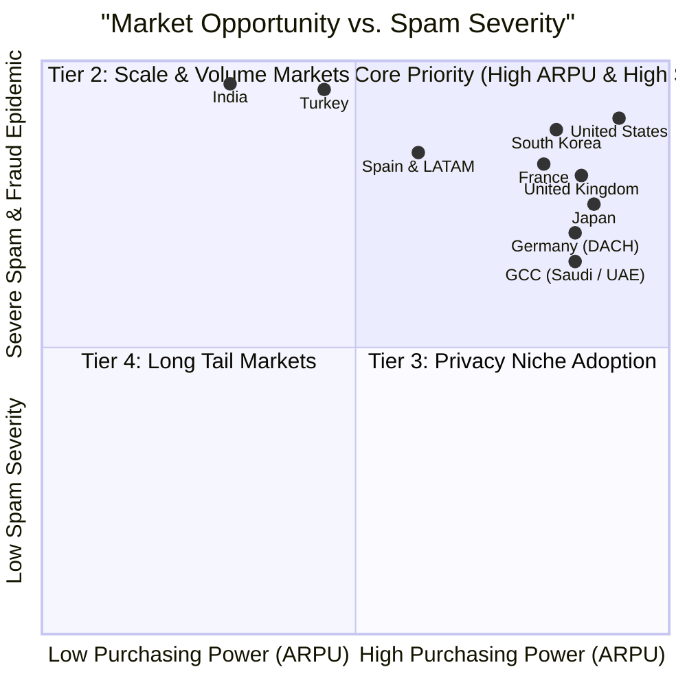

# SafeMessageShield — Global ASO & Marketing Playbook
*The Complete Multi-Language App Store Optimization & Global Growth Blueprint*

---

## Executive Summary & Core Value Proposition

**SafeMessageShield** (App ID: `6755031025`) is an on-device, zero-cloud iOS security utility engineered to filter unwanted spam SMS and block fraudulent telemarketing/robocalls.

### The Problem It Solves
Modern smartphone users are assaulted by an average of 5–15 fraudulent text messages and spam calls daily:
- Unregulated online betting and casino bonuses
- Fake postal / delivery tracking links ("your parcel was detained at customs")
- Predatory instant loan offers and payday advances
- Crypto scams and fake work-from-home Telegram job solicitations

### The Unfair Advantage (Why SafeMessageShield Wins)
Unlike legacy spam apps (Truecaller, Hiya, RoboKiller) that harvest address books and upload communication metadata to remote corporate servers:
1. **100% Offline & Zero Data Harvesting**: Built on Apple's native `IdentityLookup` and `CallKit` frameworks. Runs completely inside the device's sandbox. No accounts, no servers, zero telemetry.
2. **Dual-Layer Protection**: Categorizes unwanted SMS messages directly into the native iOS **Junk** tab (silencing notifications) and rejects spam callers at the iOS system level.
3. **Smart Protection Presets**: 1-tap activation to neutralize the 5 most widespread scam categories across **11 languages**.
4. **Interactive Sandbox Simulator Engine**: Allows users to test any sender or message text against active rules to preview filtering behavior *before* messages arrive.
5. **Pattern & Prefix Matching**: Block entire country dialing codes (+XX), carrier prefixes, and custom digit sequences.
6. **2FA OTP Guardian & Whitelist**: Guarantees bank transaction codes and family contacts always reach the primary inbox.
7. **JSON Backup & Share**: Effortless 1-click import/export for cross-device migration and sharing.

---

## 1. Global Market Opportunity & Audience Segments



---

## 2. Global ASO Master Architecture & Cross-Localization Rules

| Field | Apple Character Limit | Optimization Strategy |
| :--- | :---: | :--- |
| **App Title** | **30 characters** | Brand Name + High-Volume Primary Keyword |
| **Subtitle** | **30 characters** | Value Proposition + Secondary Search Intent |
| **Keywords** | **100 characters** | Comma-separated, **NO SPACES**, zero redundancy with Title/Subtitle |
| **Promotional Text** | **170 characters** | Flexible hook (editable without App Review build submission) |
| **Description** | **4,000 characters** | Problem hook, offline guarantee, feature list, instructions, CTA |
| **What's New** | **4,000 characters** | Release highlights focusing on user-facing benefits |

### Cross-Localization Multiplier Strategy
Apple App Store indexes multiple locales in individual storefronts. By properly deploying keywords across paired locales, you double your keyword discovery footprint:
* **US App Store**: Indexes **English (US)** + **Spanish (Mexico)**.
* **German App Store**: Indexes **German** + **English (UK)**.
* **French App Store**: Indexes **French** + **English (UK)**.
* **Turkish App Store**: Indexes **Turkish** + **English (UK)**.
* **Japan App Store**: Indexes **Japanese** + **English (US)**.
* **Korea App Store**: Indexes **Korean** + **English (US)**.

---

## 3. Complete 11-Locale Metadata Matrix

> [!IMPORTANT]
> All titles, subtitles, keywords, promotional texts, What's New notes, and descriptions below strictly conform to Apple's guidelines and have been verified with `scripts/verify_aso_limits.py`.

### 3.1. English (U.S., UK, Canada, Australia & Global)
* **Title (30/30):** `Safe Message Shield: Anti Spam`
* **Subtitle (28/30):** `Block Spam SMS & Robot Calls`
* **Keywords (99/100):** `text,junk,filter,telemarketer,scam,fraud,stop,blacklist,whitelist,offline,caller,id,protect,private`
* **Promotional Text (168/170):** `Take back control of your phone. Block spam texts and fraud calls 100% offline with zero data tracking. Try our new smart protection presets and rule simulator sandbox!`
* **What's New (v2.1):**
  ```markdown
  • Smart Protection Presets: 1-tap activation against casino, fake delivery, loan phishing, and job scam texts.
  • Interactive Rule Simulator: Test how your custom rules and blocklists evaluate messages before they arrive.
  • Pattern & Prefix Matching: Block calls and texts by country code (+XX), prefix, or digit sequences.
  • Backup & Restore: Effortlessly export and import your custom blocking lists via JSON.
  • iOS 18 performance enhancements and 100% offline privacy guarantee.
  ```
* **Full Description:**
  ```markdown
  Tired of endless spam texts, casino promotions, fake parcel delivery alerts, and intrusive robocalls?

  Safe Message Shield is your powerful, privacy-first defender for iOS. Engineered specifically to restore peace to your iPhone, Safe Message Shield automatically categorizes unwanted SMS messages into your Junk tab and suppresses unwanted phone calls entirely on your device.

  100% OFFLINE PRIVACY GUARANTEE
  Unlike legacy caller ID apps that upload your contact book, SMS messages, or call logs to external corporate servers, Safe Message Shield operates 100% offline. 
  • No external servers
  • No user accounts or login
  • No contact harvesting
  • No analytics tracking
  Your personal data never leaves your iPhone.

  SMART PROTECTION PRESETS (1-TAP ACTIVATION)
  Neutralize the most aggressive mobile scam vectors with pre-configured, localized protection packs:
  • Casino & Gambling Promotions: Silence casino bonus links, slot spam, and sports betting blasts.
  • Fake Delivery & Courier Scams: Stop phishing links pretending to be UPS, FedEx, DHL, or customs duty alerts.
  • Predatory Loan Phishing: Block instant cash, zero-interest credit traps, and debt relief scams.
  • Fake Lotteries & Gift Cards: Filter bogus prize alerts and bogus survey links.
  • Crypto & Telegram Job Solicitations: Stop unsolicited WhatsApp and Telegram work-from-home fraud.

  INTERACTIVE RULE SIMULATOR SANDBOX
  Curious how your rules work? Safe Message Shield features a built-in sandbox simulator. Test any sender name, phone number, or SMS message body against your active blocklists and rules in real-time before actual messages land in your inbox.

  ADVANCED SMS FILTERING & CALL BLOCKING
  • Keyword Filtering: Filter messages containing specific keywords or phrases straight into iOS Junk without triggering notifications.
  • Number Pattern Matching: Block callers and message senders by exact number, international dialing prefix (+XX), suffix, or containing digits.
  • Alphabetic Sender Identification: Block alphanumeric sender tags commonly abused by commercial bulk SMS gateways.
  • Whitelist & 2FA Guardian: Add trusted family contacts and banking institutions to ensure mission-critical two-factor authentication (OTP) codes always reach you immediately.

  EXPORT, IMPORT & AUDIT
  Full ownership of your rules. Export your complete blocklist and filtering rules to a standard JSON file with one tap. Easily back up your setup or migrate your settings across your devices.

  NATIVE & LIGHTWEIGHT
  Built with Swift and Apple's native IdentityLookup and CallKit architectures. Safe Message Shield consumes virtually zero battery and operates silently in the background even when the app is closed.

  Take back control of your notifications today. Download Safe Message Shield and experience a clean, distraction-free inbox!
  ```

---

### 3.2. Türkçe (Türkiye & Turkish Diaspora)
* **Title (30/30):** `Safe Message Shield: Spam Blok`
* **Subtitle (30/30):** `SMS Filtresi & Arama Engelleme`
* **Keywords (100/100):** `istenmeyen,mesaj,numara,dolandirici,bahis,casino,kargo,kredi,gizlilik,guvenlik,kara,liste,cevrildisi`
* **Promotional Text (166/170):** `Telefonunuzun kontrolünü geri alın. İstenmeyen SMS ve aramaları %100 çevrimdışı ve gizli engelleyin. Akıllı koruma paketleri ve canlı simülatör sandbox şimdi yayında!`
* **What's New (v2.1):**
  ```markdown
  • Akıllı Koruma Paketleri: Bahis, sahte kargo, kredi dolandırıcılığı ve iş vaatlerini tek dokunuşla engelleyin.
  • Canlı Test Laboratuvarı: Kurallarınızın gelen mesajları nasıl işleyeceğini önceden simüle edin.
  • Numara & Ön Ek Kuralları: Ülke koduna (+XX), ön eke veya numaraya göre gelişmiş engelleme.
  • Kural Yedekleme: Engelleme listelerinizi tek tıkla JSON olarak yedekleyin ve geri yükleyin.
  • %100 çevrimdışı mimari ve iOS 18 performans optimizasyonları.
  ```
* **Full Description:**
  ```markdown
  Günde onlarca bahis reklamı, sahte kargo takip SMS'i ve rahatsız edici pazarlama aramasından bıktınız mı?

  Safe Message Shield, iPhone'unuz için özel olarak tasarlanmış, %100 gizlilik odaklı ve çevrimdışı çalışan yeni nesil spam engelleme kalkanıdır. Mesaj kutunuzu temiz tutar, telefonunuzun gereksiz bildirimlerle çalmasını engeller.

  %100 ÇEVRİMDIŞI VE TAM GİZLİLİK
  Rehberinizi, mesajlarınızı ve arama kayıtlarınızı yabancı sunuculara yükleyen popüler arayan kimliği uygulamalarını unutun. Safe Message Shield tamamen cihazınızda çalışır.
  • Sunucu yok, bulut aktarımı yok
  • Üyelik veya hesap zorunluluğu yok
  • Rehber kopyalama yok
  • Reklam veya takip kodu yok
  Tüm verileriniz yalnızca sizin iPhone'unuzda kalır.

  AKILLI KORUMA PAKETLERİ (TEK DOKUNUŞLA AKTİF)
  Türkiye'deki en yaygın spam ve dolandırıcılık türlerini tek bir dokunuşla engelleyin:
  • Bahis ve Casino Mesajları: Sürekli gelen deneme bonusu, freespin ve canlı bahis reklamlarını otomatik olarak İstenmeyen (Junk) sekmesine yönlendirir.
  • Sahte Kargo ve Gümrük SMS'leri: "Paketiniz teslim edilemedi", "gümrük vergisi ödeyin" gibi oltalama tuzaklarını durdurur.
  • Ön Onaylı Kredi ve Finans Tuzakları: Dosya masrafı, acil nakit ve sicil affı vaatlerini filtreler.
  • Çekiliş ve Hediye Dolandırıcılığı: Sahte hediye çeki ve ödül tuzaklarını engeller.
  • Kripto ve Sahte İş Vaatleri: Telegram ve WhatsApp üzerinden yönlendirilen evden çalışma tekliflerini susturur.

  CANLI FİLTRE SİMÜLATÖRÜ (TEST SANDBOX)
  Kurallarınızın nasıl çalıştığını merak mı ediyorsunuz? Uygulama içindeki interaktif simülatör sayesinde istediğiniz gönderen numarasını veya SMS metnini yazarak kurallarınızın bunu nasıl değerlendireceğini gerçek bir SMS gelmeden önce anında test edin.

  GELİŞMİŞ SMS FİLTRELEME VE NUMARA ENGELLEME
  • Anahtar Kelime Kuralları: Belirlediğiniz kelimeleri içeren SMS'leri doğrudan sessizce İstenmeyen klasörüne gönderin.
  • Numara Desen Eşleme: Numaraları tam eşleşme, ülke/alan kodu (+90 vb.), ön ek, son ek veya parça eşleşmeyle engelleyin.
  • Metinsel Gönderici Engelleme: SMS başlıklarında yer alan kurumsal veya sahte alfanumerik başlıkları engelleyin.
  • Beyaz Liste ve Banka Onay Kodu (OTP) Kalkanı: Güvendiğiniz kişileri ve bankalarınızı ekleyerek kritik 2FA onay kodlarının asla kaybolmamasını sağlayın.

  JSON YEDEKLEME VE KURALLARI PAYLAŞMA
  Oluşturduğunuz engelleme kurallarını tek dokunuşla standart JSON dosyası olarak dışa aktarın. Cihaz değiştirirken kolayca geri yükleyin veya sevdiklerinizle paylaşın.

  APPLE STANDARTLARINDA DOĞAL VE HAFİF
  Apple'ın resmi IdentityLookup ve CallKit altyapısı üzerine inşa edilmiştir. Arka planda pil tüketmez, cihazınızı yormaz ve uygulama tamamen kapalıyken bile kesintisiz koruma sağlar.

  Telefonunuzda huzuru yeniden yakalayın. Safe Message Shield'ı hemen indirin!
  ```

---

### 3.3. Deutsch (Germany, Austria, Switzerland)
* **Title (30/30):** `Safe Message Shield: Anti-Spam`
* **Subtitle (30/30):** `SMS Filter & Anrufe Blockieren`
* **Keywords (98/100):** `werbung,unerwuenscht,betrug,abzocke,phishing,kredit,paket,datenschutz,sperre,offline,privat,schutz`
* **Promotional Text (163/170):** `Schützen Sie sich vor SMS-Spam und betrügerischen Anrufen. 100% offline, keine Server, vollkommene Privatsphäre. Jetzt mit intelligenten Schutzpaketen & Simulator!`
* **What's New (v2.1):**
  ```markdown
  • Intelligente Schutzpakete: 1-Klick-Schutz vor Casino-Spam, gefälschten Paketen und Phishing.
  • Filter-Simulator: Testen Sie Ihre Regeln direkt in einer interaktiven Sandbox.
  • Vorwahl- und Ländercode-Filter: Sperren nach Landesvorwahl (+XX) oder Rufnummernblöcken.
  • Backup & Restore: Exportieren und importieren Sie Ihre Sperrlisten jederzeit als JSON.
  • Vollständige iOS 18 Optimierung und garantierter Datenschutz ohne Cloud.
  ```
* **Full Description:**
  ```markdown
  Genervt von ständigen Spam-SMS, unerwünschten Werbeanrufen, Casino-Gutscheinen und gefälschten Paket-Benachrichtigungen?

  Safe Message Shield ist Ihr kompromissloser, datenschutzorientierter Schutzschild für iOS. Entwickelt nach den höchsten europäischen Datenschutzstandards filtert Safe Message Shield unerwünschte SMS-Nachrichten automatisch in Ihren iOS-Junk-Ordner und blockiert aggressive Werbeanrufe direkt auf Systemebene.

  100% OFFLINE-DATENSCHUTZ (ZERO-CLOUD-GARANTIE)
  Während herkömmliche Anrufer-ID-Apps Ihr Adressbuch auf fremde Server hochladen, arbeitet Safe Message Shield zu 100% offline auf Ihrem Gerät.
  • Keine externen Server oder Cloud-Verbindungen
  • Keine Registrierung oder Benutzerkonten
  • Kein Zugriff auf Ihre privaten Kontakte
  • Kein Tracking und keine Werbe-SDKs
  Ihre privaten Nachrichten und Sperrlisten verlassen niemals Ihr iPhone.

  INTELLIGENTE SCHUTZPAKETE (1-KLICK-AKTIVIERUNG)
  Schützen Sie sich sofort vor den häufigsten Betrugsmustern:
  • Casino & Sportwetten: Blockiert aufdringliche Spielbanken, Freispiele und Bonusangebote.
  • Gefälschte Paketdienste (Phishing): Filtert betrügerische SMS über angebliche Zollgebühren oder Sendungsverfolgungen (DHL, Hermes, UPS).
  • Kredit- und Abzockfallen: Verhindert dubiose Sofortkredite, Blitzgeld-Versprechen und Entschuldungs-Spam.
  • Gewinnspiele & Gutscheine: Schützt vor gefälschten Einkaufsgutscheinen und Gewinnbenachrichtigungen.
  • Krypto- & Job-Betrug: Filtert unerwünschte WhatsApp- und Telegram-Jobangebote.

  INTERAKTIVER FILTER-SIMULATOR
  Möchten Sie wissen, wie Ihre Regeln greifen? Mit der integrierten Test-Sandbox können Sie beliebige Telefonnummern, Absendernamen oder Nachrichtentexte simulieren und sofort sehen, ob eine Nachricht zugestellt, als Junk markiert oder geblockt wird – noch bevor echte Nachrichten eintreffen.

  LEISTUNGSSTARKE FILTER- UND SPERRFUNKTIONEN
  • Keyword-Filter: Leiten Sie Nachrichten mit bestimmten Schlagwörtern geräuschlos in den Junk-Ordner.
  • Ziffern- und Mustermatching: Blockieren Sie Rufnummern nach exakter Nummer, Landesvorwahl (+XX), Vorwahlbereichen oder Rufnummernblöcken.
  • Absender-Erkennung: Sperren Sie alphabetische Absenderkennungen von Massen-SMS-Diensten.
  • Whitelist & 2FA-Schutz: Schützen Sie wichtige Bankkontakte und Einmal-Passwörter (OTP), damit Verifizierungscodes immer zuverlässig ankommen.

  BACKUP UND REGEL-EXPORT
  Exportieren Sie Ihre Konfiguration und Blocklisten jederzeit mit einem Fingertipp als standardisierte JSON-Datei. Ideal für Backups oder den Wechsel auf ein neues iPhone.

  NATIVER SYSTEMSCHUTZ FÜR IOS
  Nutzt die offiziellen Apple Frameworks IdentityLookup und CallKit. Nahezu null Akkuverbrauch und zuverlässiger Schutz im Hintergrund – selbst wenn die App geschlossen ist.

  Holen Sie sich Ihre Ruhe zurück. Laden Sie Safe Message Shield jetzt herunter!
  ```

---

### 3.4. Français (France, Belgium, Switzerland, Canada)
* **Title (29/30):** `Safe Message Shield Anti Spam`
* **Subtitle (29/30):** `Bloqueur de SMS & Appels Spam`
* **Keywords (94/100):** `indesirable,filtrage,bloquer,arnaque,fraude,demarchage,prive,securite,colis,casino,liste,noire`
* **Promotional Text (167/170):** `Bloquez les SMS indésirables et appels spam 100% hors-ligne. Vos données ne quittent jamais votre iPhone. Découvrez les packs de protection et le bac à sable de test !`
* **What's New (v2.1):**
  ```markdown
  • Packs de protection intelligente : activez en 1 clic le blocage des arnaques au colis, casino et crédits.
  • Bac à sable interactif : simulez l'évaluation de vos règles de filtrage avant réception.
  • Règles de préfixes et pays : bloquez par indicatif international (+XX) ou séries de numéros.
  • Sauvegarde & Restauration : exportez facilement vos listes de blocage en JSON.
  • Optimisation iOS 18 et garantie 100% hors-ligne sans serveur.
  ```
* **Full Description:**
  ```markdown
  Excédé par le démarchage téléphonique agressif, les faux SMS de livraison de colis, les spams de casino et les tentatives d'hameçonnage ?

  Safe Message Shield est votre bouclier de sécurité nouvelle génération sur iOS. Conçu avec une approche stricte de respect de la vie privée, Safe Message Shield filtre automatiquement les SMS indésirables vers votre boîte "Indésirables" iOS et bloque les appels frauduleux directement au niveau du système.

  100% HORS-LIGNE ET RESPECT ABSOLU DE LA VIE PRIVÉE
  Contrairement aux applications d'identification d'appel traditionnelles qui siphonnent votre carnet d'adresses et envoient vos métadonnées sur des serveurs distants, Safe Message Shield s'exécute à 100% en local sur votre iPhone.
  • Aucun serveur externe, aucun cloud
  • Aucune création de compte ou inscription
  • Aucun accès ni téléchargement de vos contacts
  • Aucun traceur ni SDK publicitaire
  Vos communications et vos listes de règles ne quittent jamais votre appareil.

  PACKS DE PROTECTION INTELLIGENTE (ACTIVATION EN 1 TAP)
  Neutralisez immédiatement les escroqueries mobiles les plus courantes :
  • Paris et Casinos en ligne : Bloque les spams de tours gratuits, machines à sous et incitations aux paris sportifs.
  • Fausses livraisons de colis (Phishing) : Élimine les faux avis de passage ou demandes de taxes douanières prétendant venir de Colissimo, Chronopost, Mondial Relay ou DHL.
  • Prêts et Crédits abusifs : Filtre les propositions de crédit rapide sans justificatif et de rachat de dettes.
  • Faux gains et cartes-cadeaux : Écarte les alertes frauduleuses de tirages au sort.
  • Arnaques à l'emploi et Crypto : Neutralise les sollicitations d'emploi non sollicitées via WhatsApp ou Telegram.

  BAC À SABLE ET SIMULATEUR DE RÈGLES
  Découvrez précisément comment vos règles réagissent ! Grâce au simulateur interactif intégré, saisissez n'importe quel numéro ou texte de message pour prévisualiser instantanément la décision de filtrage avant même qu'un véritable message n'arrive.

  CONTRÔLE TOTAL DU FILTRAGE
  • Filtrage par mots-clés : Classez les SMS contenant des termes spécifiques directement dans les indésirables sans aucune sonnerie.
  • Filtrage par motifs de numéros : Bloquez par correspondance exacte, indicatif téléphonique international (+XX), préfixe d'opérateur ou suite de chiffres.
  • Blocage d'expéditeurs alphabétiques : Interceptez les expéditeurs commerciaux textuels non sollicités.
  • Liste blanche et protection 2FA : Ajoutez vos contacts clés et vos banques afin de ne jamais manquer un code d'authentification par SMS (OTP).

  EXPORT ET IMPORTATION JSON
  Gardez la pleine maîtrise de vos données. Exportez vos règles et listes noires au format JSON en un instant pour créer une sauvegarde ou les transférer vers un autre appareil.

  INTÉGRATION NATIVE IOS
  Exploite les frameworks officiels d'Apple IdentityLookup et CallKit. Fonctionne en arrière-plan avec un impact nul sur l'autonomie de votre batterie.

  Retrouvez la tranquillité d'un téléphone sans spam. Téléchargez Safe Message Shield dès aujourd'hui !
  ```

---

### 3.5. Español (Spain & Latin America)
* **Title (29/30):** `Safe Message Shield Anti Spam`
* **Subtitle (29/30):** `Filtro SMS y Bloqueo Llamadas`
* **Keywords (98/100):** `bloquear,mensajes,texto,estafa,fraude,publicidad,privacidad,desconocido,molestos,seguridad,offline`
* **Promotional Text (164/170):** `Dile adiós a los mensajes spam y llamadas no deseadas. 100% offline y con total privacidad. ¡Prueba los paquetes de protección inteligente y el simulador de reglas!`
* **What's New (v2.1):**
  ```markdown
  • Paquetes de protección inteligente: bloqueo con un toque de apuestas, paquetes falsos y préstamos.
  • Simulador interactivo: comprueba cómo reaccionan tus reglas ante cualquier mensaje o número.
  • Filtro por prefijos y país: bloquea llamadas y SMS por código de país (+XX) o secuencias numéricas.
  • Copia de seguridad: exporta e importa tus listas de filtros en formato JSON.
  • Optimizado para iOS 18 y garantía 100% local sin servidores externos.
  ```
* **Full Description:**
  ```markdown
  ¿Cansado de los mensajes de texto spam, avisos falsos de entrega de paquetes, publicidad de casinos y llamadas comerciales a deshoras?

  Safe Message Shield es tu escudo defensivo definitivo en iOS. Creado bajo una filosofía de privacidad total, Safe Message Shield filtra automáticamente los SMS molestos hacia la bandeja de "No deseados" de iOS y bloquea las llamadas comerciales directamente en el sistema.

  100% OFFLINE Y PRIVACIDAD ABSOLUTA
  A diferencia de otras aplicaciones de identificación de llamadas que recopilan tu agenda de contactos y suben tus registros a servidores en la nube, Safe Message Shield funciona al 100% de forma local en tu dispositivo.
  • Sin servidores externos ni almacenamiento en la nube
  • Sin necesidad de registros ni cuentas de usuario
  • Sin extracción ni lectura de tus contactos
  • Cero rastreadores y cero publicidad
  Tu información personal jamás sale de tu iPhone.

  PAQUETES DE PROTECCIÓN INTELIGENTE (1 TOQUE)
  Activa al instante filtros contra los fraudes móviles más frecuentes:
  • Apuestas y Casinos: Silencia promociones de tiradas gratis, bonos de bienvenida y ruletas.
  • Phishing de Paquetería: Detén los SMS falsos que simulan entregas fallidas o pagos de aduanas (Correos, DHL, Seur).
  • Préstamos Engañosos: Bloquea ofertas de dinero rápido, créditos sin aval y falsos desendeudamientos.
  • Loterías y Premios Falsos: Filtra premios fraudulentos y tarjetas de regalo inexistentes.
  • Fraudes de Empleo y Cripto: Evita ofertas no solicitadas de trabajo falso procedentes de Telegram o WhatsApp.

  SIMULADOR INTERACTIVO DE REGLAS
  ¿Quieres comprobar la eficacia de tus filtros? Utiliza nuestro simulador integrado en tiempo real. Escribe cualquier número de teléfono, nombre de remitente o texto de mensaje para comprobar al instante cómo actuarán tus reglas antes de que los mensajes reales lleguen.

  POTENTE MOTOR DE REGLAS
  • Filtro por Palabras Clave: Envía directamente a la carpeta de correo no deseado cualquier SMS que contenga palabras específicas, sin molestarte con notificaciones.
  • Reglas de Números y Prefijos: Bloquea por coincidencia exacta, código de país (+XX), prefijos de provincias o secuencias de dígitos.
  • Bloqueo de Remitentes de Texto: Intercepta remitentes alfanuméricos utilizados por plataformas de mensajería masiva.
  • Lista Blanca y Protección 2FA: Registra tus contactos bancarios e instituciones seguras para garantizar que tus códigos de verificación por SMS lleguen siempre sin demoras.

  COPIAS DE SEGURIDAD EN JSON
  Exporta e importa tus listas de filtros con un solo clic. Guarda una copia de seguridad o transfiere fácilmente tu configuración a otro iPhone.

  NATIVO Y EFICIENTE
  Integrado con los frameworks oficiales IdentityLookup y CallKit de Apple. Máxima velocidad, nulo consumo de batería y protección continua en segundo plano.

  Recupera la tranquilidad en tu móvil. ¡Descarga Safe Message Shield hoy mismo!
  ```

---

### 3.6. 简体中文 (China, Singapore & Global Chinese)
* **Title (24/30):** `Safe Message Shield 骚扰拦截`
* **Subtitle (15/30):** `垃圾短信过滤与骚扰电话智能拦截`
* **Keywords (42/100):** `防骚扰,垃圾短信,黑名单,离线过滤,防诈骗,隐私保护,电销拦截,博彩拦截,短信拦截器`
* **Promotional Text (60/170):** `告别垃圾短信与骚扰电话！100%纯本地离线运行，零数据上传，彻底守护通信隐私。现已上线智能防护预设包与交互式规则模拟器！`
* **What's New (v2.1):**
  ```markdown
  • 智能防护预设包：一键拦截博彩推广、虚假快递、高利贷及刷单兼职诈骗。
  • 交互式规则模拟器：在真实短信到达前，沙盒预览当前规则的拦截判定效果。
  • 区号与号段规则：支持按国际区号（+XX）、号码前缀或特定数字组合批量拦截。
  • 规则备份与恢复：支持一键导出和导入自定义黑白名单（JSON格式）。
  • 针对 iOS 18 极致优化，全离线架构守护隐私。
  ```
* **Full Description:**
  ```markdown
  厌倦了频繁轰炸的澳门博彩短信、虚假快递取件链接、高利贷推销以及各种电销骚扰电话？

  Safe Message Shield 是专为 iOS 深度打造的纯本地、高私密性防骚扰工具。利用苹果原生架构，在设备端无感将垃圾短信移至“垃圾短信”分类，并智能拦截骚扰电话，让您的手机重归宁静。

  100% 离线运行，严密守护隐私
  区别于其他需要上传通讯录、将短信与通话记录同步至云端数据库的骚扰拦截软件，Safe Message Shield 严格坚守设备端独立运算：
  • 绝无外部服务器，绝无云端传输
  • 无需注册任何账号
  • 绝不扫描或读取您的私人通讯录
  • 无任何第三方数据分析或追踪 SDK
  您的所有通信数据与规则永远停留在您的 iPhone 本地。

  一键开启智能防护预设包
  针对主流高频电信网络诈骗，内置开箱即用的本地规则包：
  • 线上博彩与赌博推广：一键阻断真人视讯、百家乐、免充首存及彩票推广信息。
  • 虚假快递钓鱼短信：精准拦截以派送失败、更新收货地址、缴纳关税为诱饵的危险链接。
  • 贷款与办卡骚扰：过滤秒批到账、免息借款、小额极速贷等信贷陷阱。
  • 中奖与积分诈骗：屏蔽虚假抽奖、领取礼品卡等诱导短信。
  • 刷单与兼职诈骗：截断境外引流至微信或 Telegram 的虚假工作信息。

  交互式规则判定模拟器
  想知道设置的规则是否生效？内置沙盒模拟器！无需等待真实垃圾短信，您可自行输入任意测试号码、发件人名称或短信内容，毫秒级验证规则判定走向（放行、归类垃圾箱或拦截）。

  强大的自定义规则引擎
  • 关键词过滤：命中指定关键词的短信将被静默移送至 iOS 垃圾短信箱，不发出震动提示。
  • 号码与号段匹配：支持按完整号码、国际区号（如 +86）、号段前缀、后缀或包含特定数字组合进行精准批量拦截。
  • 文本发信人识别：拦截通过商业群发通道发送的字母发件人。
  • 白名单与验证码护航：支持添加银行、政务与重要联系人白名单，确保各类动态验证码（OTP）稳定抵达，万无一失。

  便捷的 JSON 备份与迁移
  支持一键导出自定义拦截规则为标准化 JSON 文件，方便在不同 iPhone 间轻松迁移或与家人共享规则包。

  苹果官方原生扩展开发
  深度调用 Apple IdentityLookup 和 CallKit 框架。后台常驻零耗电，应用关闭状态下依然保持全天候静默守卫。

  立即下载 Safe Message Shield，还您干净无扰的通信空间！
  ```

---

### 3.7. 日本語 (Japan)
* **Title (24/30):** `Safe Message Shield 迷惑防止`
* **Subtitle (15/30):** `迷惑SMSフィルター＆着信拒否`
* **Keywords (49/100):** `迷惑メール,着信拒否,スパム,ブロック,詐欺,広告,プライバシー,安全,オフライン,ブラックリスト`
* **Promotional Text (75/170):** `迷惑SMSやしつこいセールス電話を自動シャットアウト。完全オフライン動作でプライバシーも安心。新機能のスマート保護プリセット＆判定シミュレーター搭載！`
* **What's New (v2.1):**
  ```markdown
  • スマート保護プリセット：不在配達詐欺、カジノ勧誘、投資詐欺をワンタップで一括ブロック。
  • 判定シミュレーター：設定したルールやブラックリストの判定挙動を事前にサンドボックスでテスト。
  • 国番号・局番ルール：国番号（+XX）や特定プレフィックスでの一括拒否に対応。
  • バックアップと復元：作成したルールリストをJSON形式で簡単にエクスポート/インポート可能。
  • iOS 18 への完全最適化とオフラインでのプライバシー保護。
  ```
* **Full Description:**
  ```markdown
  不在配達を装ったフィッシング詐欺SMS、オンラインカジノの勧誘、しつこいセールス電話に悩まされていませんか？

  Safe Message Shield は、iPhoneユーザーのために設計された、完全ローカル動作・プライバシー最優先の迷惑通信対策アプリです。不要なSMSを自動でiOSの「迷惑メッセージ」フォルダへ仕分けし、悪質な電話をシステムレベルでシャットアウトします。

  100% オフライン＆安心のプライバシー設計
  連絡先データを外部サーバーへアップロードして照合する従来の番号識別アプリとは異なり、Safe Message Shield は全ての判定をiPhone端末内だけで行います。
  • 外部サーバーやクラウド通信は一切不使用
  • アカウント登録やログイン不要
  • アドレス帳のアップロードや読み取りなし
  • 追跡トラッカーや広告SDKはゼロ
  お客様の個人情報や通信内容が端末の外に出ることは一切ありません。

  スマート保護プリセット（ワンタップで一括設定）
  日本国内で多発する悪質な迷惑メッセージパターンをワンタップでブロック：
  • 不在配達・宅配偽装フィッシング：ヤマト運輸や佐川急便などを装う偽の不在通知や再配達依頼リンクを強力ブロック。
  • オンラインカジノ＆スロット勧誘：入金不要ボーナスやギャンブル関連のメッセージを自動排除。
  • 不審な融資・即日現金化：無審査ローンやブラックOKなどの金融詐欺SMSを即座に迷惑フォルダへ。
  • 当選詐欺・ギフトカード偽装：ギフト券プレゼントや高額当選を謳う詐欺メッセージを遮断。
  • 副業・闇バイト勧誘：TelegramやLINEへ誘導する不審な高額報酬メッセージを防止。

  テスト判定シミュレーター搭載
  自作のルールが正しく機能するか不安な場合も安心。アプリ内のシミュレーターを使えば、任意の電話番号やメッセージ文面を入力するだけで、実際のSMSを受信する前に判定結果（通常受信、迷惑フォルダ行き、拒否）をリアルタイムで確認できます。

  自由度の高い詳細ルール設定
  • キーワードフィルター：指定した単語を含むSMSを通知音なしで迷惑フォルダへ直行。
  • 番号パターンマッチング：完全一致、国番号（+81など）、特定市外局番、接頭辞・接尾辞での一括拒否に対応。
  • 英字差出人拒否：SMS送信ゲートウェイ経由のアルファベット送信者をしっかりブロック。
  • ホワイトリスト（認証コード保護）：金融機関や重要な連絡先を許可リストに登録し、2要素認証（OTP）SMSを確実に受信。

  JSONバックアップ＆簡単共有
  設定したルールリストはワンタップでJSONファイルとして書き出し可能。機種変更時も瞬時に復元できます。

  Apple公式フレームワーク採用
  iOS公式の「IdentityLookup」および「CallKit」に完全準拠。アプリを起動していなくてもバッテリーを消費せず、24時間バックグラウンドでiPhoneを静かに守り続けます。

  平穏なスマートフォンライフを取り戻しましょう。今すぐ Safe Message Shield をダウンロード！
  ```

---

### 3.8. 한국어 (South Korea)
* **Title (25/30):** `Safe Message Shield 스팸 차단`
* **Subtitle (20/30):** `스팸 문자 필터링 & 광고 전화 차단`
* **Keywords (43/100):** `스팸문자,광고차단,전화거부,보이스피싱,스미싱,개인정보,오프라인,안심,필터,차단기`
* **Promotional Text (87/170):** `귀찮은 스팸 문자와 보이스피싱 전화를 완벽 차단하세요. 100% 오프라인 작동으로 개인정보 유출 걱정 제로. 원클릭 스마트 보호 팩과 규칙 시뮬레이터 제공!`
* **What's New (v2.1):**
  ```markdown
  • 스마트 보호 팩: 불법 도박, 가짜 택배 스미싱, 대출 유도, 부업 사기 문자를 원클릭으로 일괄 차단.
  • 필터 시뮬레이터: 실제 문자가 오기 전 내 필터 규칙이 어떻게 동작하는지 미리 테스트하는 샌드박스.
  • 국번 및 패턴 차단: 국가번호(+XX), 지역번호, 특정 번호 패턴 단위의 맞춤 차단 지원.
  • 규칙 백업 및 복원: 차단 및 허용 규칙을 JSON 파일로 간편하게 내보내고 가져오기.
  • iOS 18 완벽 대응 및 100% 오프라인 개인정보 보호.
  ```
* **Full Description:**
  ```markdown
  하루에도 수십 번씩 울리는 불법 도박 광고, 가짜 택배 미수령 문자(스미싱), 대출 스팸 전화에 지치셨나요?

  Safe Message Shield 는 iPhone 사용자를 위해 특별히 설계된 100% 오프라인 기반의 강력한 프라이버시 스팸 차단 솔루션입니다. 불필요한 스팸 문자를 iOS의 '정크(스팸)' 보관함으로 자동 격리하고, 집요한 광고 전화를 시스템 수준에서 완벽하게 차단합니다.

  100% 온디바이스 오프라인 & 철저한 개인정보 보호
  연락처 목록을 외부 서버로 전송하여 매칭하는 기존 스팸 차단 앱들과 달리, Safe Message Shield 는 기기 내부에서 모든 연산을 독립적으로 수행합니다.
  • 외부 서버 및 클라우드 연동 일체 없음
  • 회원가입 및 계정 등록 불필요
  • 사용자 연락처 수집 및 외부 업로드 절대 금지
  • 광고 추적기 및 타사 애널리틱스 제로
  귀하의 문자 메시지와 통신 데이터는 오직 본인의 iPhone에만 안전하게 남습니다.

  스마트 보호 팩 (원클릭 일괄 활성화)
  한국 내에서 가장 빈번하게 발생하는 주요 금융 사기 및 스팸 패턴을 터치 한 번으로 차단하세요:
  • 불법 도박 및 카지노: 바카라, 첫충 보너스, 꽁머니, 슬롯 등 불법 사행성 홍보 문자를 원천 차단합니다.
  • 택배 배송 사기 (스미싱): '주소지 불명', '통관비용 납부' 등 가짜 배송 조회 링크가 포함된 악성 문자를 걸러냅니다.
  • 불법 대출 및 고금리 사기: 당일대출, 무서류 대출, 저금리 대환 등 사기성 대출 유혹을 사전에 차단합니다.
  • 가짜 경품 및 당첨 사기: 백화점 상품권 지급, 이벤트 당첨 사기를 방어합니다.
  • 가짜 부업 및 리딩방 사기: 텔레그램이나 카카오톡 오픈채팅방으로 유인하는 고수익 알바 사기를 차단합니다.

  실시간 필터 시뮬레이터 (샌드박스)
  내가 설정한 차단 규칙이 제대로 동작할지 궁금하신가요? 앱 내에 탑재된 대화형 시뮬레이터를 통해 가상의 번호나 문자 내용을 입력하여 실제 문자가 수신되기 전 정상 통과, 정크 분류, 통화 거부 여부를 미리 확인해볼 수 있습니다.

  정밀한 규칙 맞춤 설정
  • 키워드 필터링: 특정 단어가 포함된 문자를 알림 없이 조용히 정크 보관함으로 이동시킵니다.
  • 번호 패턴 차단: 완전 일치 번호는 물론 국가번호(+XX), 지역번호(02, 070 등), 접두사/접미사 단위의 패턴 차단이 가능합니다.
  • 문자형 발신자 차단: 영문 알파벳으로 발송되는 기업형 대량 스팸 발신자를 차단합니다.
  • 화이트리스트 & 2차 인증(OTP) 보호: 주요 은행 및 금융기관을 허용 목록에 등록하여 중요한 본인인증 번호가 유실되지 않도록 보장합니다.

  JSON 백업 및 손쉬운 복원
  내가 설정한 모든 규칙을 단 한 번의 탭으로 표준 JSON 파일로 내보내어 안전하게 백업하거나 다른 iPhone으로 손쉽게 이전할 수 있습니다.

  Apple 공식 프레임워크 지원
  Apple의 공식 IdentityLookup 및 CallKit 기술을 준수하여 제작되었습니다. 배터리 소모가 거의 없으며, 앱이 완전히 종료된 상태에서도 백그라운드에서 24시간 철통 방어를 유지합니다.

  지금 Safe Message Shield를 다운로드하고 방해 없는 깨끗한 일상을 되찾으세요!
  ```

---

### 3.9. العربية (Middle East & North Africa)
* **Title (30/30):** `Safe Message Shield: مانع سبام`
* **Subtitle (28/30):** `تصفية الرسائل وحظر المكالمات`
* **Keywords (73/100):** `ازعاج,احتيال,اعلانات,مكالمات,خصوصية,حماية,ارقام,نصوص,فلترة,غير,مرغوب,امان`
* **Promotional Text (153/170):** `تخلص نهائياً من الرسائل المزعجة والمكالمات الاحتيالية بنسبة 100% دون اتصال بالإنترنت ودون مشاركة بياناتك. استمتع بحزم الحماية الذكية ومحاكي القواعد الآن!`
* **What's New (v2.1):**
  ```markdown
  • حزم الحماية الذكية: تفعيل فوري بلمسة واحدة لحظر رسائل القمار، والطرود المزيفة، والاحتيال المالي.
  • محاكي القواعد التفاعلي: اختبر مسبقاً طريقة تصفية رسائلك في بيئة تجريبية آمنة.
  • قواعد الأرقام ومفاتيح الدول: حظر بالمفتاح الدولي (+XX) أو بادئات الأرقام بسهولة.
  • النسخ الاحتياطي والاستعادة: تصدير واستيراد قواعدك بتنسيق JSON بكل سهولة.
  • تحسينات شاملة لنظام iOS 18 وضمان الخصوصية دون اتصال بالإنترنت.
  ```
* **Full Description:**
  ```markdown
  هل تعاني من سيل الرسائل النصية المزعجة، وعروض المقامرة الوهمية، وإشعارات الطرود البريدية المزيفة، والمكالمات الاحتيالية المتكررة؟

  Safe Message Shield هو درعك الأمني المتطور على نظام iOS، المصمم وفق أعلى معايير الخصوصية لحماية هاتفك. يقوم التطبيق تلقائياً بتوجيه الرسائل النصية المزعجة إلى مجلد "غير المرغوب فيه" (Junk) في نظام iOS، وحظر المكالمات المزعجة على مستوى النظام مباشرة.

  خصوصية تامة 100% دون اتصال بالإنترنت (Zero-Cloud)
  على عكس تطبيقات كاشف الأرقام التقليدية التي ترفع جهات اتصالك وسجلاتك إلى خوادم سحابية خارجية، يعمل Safe Message Shield محلياً بالكامل على جهازك الآيفون:
  • لا توجد أي خوادم خارجية أو تخزين سحابي
  • لا يتطلب إنشاء حساب أو تسجيل دخول
  • لا يصل إطلاقاً إلى جهات اتصالك الخاصة ولا يسحبها
  • خالٍ تماماً من أدوات التتبع أو الإعلانات
  جميع رسائلك وقوائم الحظر تظل آمنة ومحفوظة على هاتفك فقط.

  حزم الحماية الذكية (تفعيل بلمسة واحدة)
  تصدَّ لأكثر أشكال الاحتيال الرقمي انتشاراً في المنطقة بلمسة زر واحدة:
  • رسائل المراهنات والقمار: حظر روابط المكافآت وعروض الكازينو المزعجة.
  • احتيال الشحنات والطرود المزيفة: منع روابط التصيد التي تدعي وصول طرد بريدي أو دفع رسوم جمركية معلقة.
  • القروض المشبوهة والاحتيال المالي: تصفية عروض السلف الفورية والقروض الوهمية غير المعتمدة.
  • الجوائز واليانصيب الوهمي: حظر الرسائل التي تدعي فوزك بجوائز نقدية أو بطاقات هدايا.
  • احتيال التوظيف والاستثمار: كبح الرسائل التي تدعو لفرص عمل وهمية عبر تيليجرام أو واتساب.

  محاكي القواعد التفاعلي (بيئة تجريبية)
  هل تود التأكد من فاعلية قواعدك؟ يتيح لك المحاكي المدمج كتابة أي رقم هاتف أو اسم مرسل أو نص رسالة لتشاهد على الفور وبشكل تفاعلي كيف ستتعامل قواعدك معه قبل وصول أي رسالة حقيقية.

  محرك قواعد متقدم وقابل للتخصيص
  • فلترة الكلمات المفتاحية: توجيه أي رسالة تحتوي على كلمات معينة إلى صندوق المهملات بصمت تام وبدون إشعارات.
  • مطابقة أنماط الأرقام: الحظر بالرقم الكامل، أو بمفتاح الدولة (+XX)، أو بالبادئة، أو باللاحقة.
  • حظر أسماء المرسلين النصية: حظر الرسائل التي تستخدم أسماء ترويجية عامة بدون أرقام.
  • القائمة البيضاء وحماية رموز التحقق (OTP): تأمين وصول رموز التحقق البنكية ورسائل الأقارب الموثوقين دائماً دون أي تأخير.

  تصدير واستيراد بصيغة JSON
  احتفظ بالتحكم الكامل في بياناتك. قم بتصدير أو استيراد قوائم الحظر وقواعدك بلمسة واحدة لمشاركتها أو استعادتها على جهاز جديد.

  تكامل أصلي مع تقنيات Apple
  يعتمد كلياً على واجهات IdentityLookup و CallKit الرسمية من Apple. استهلاك شبه منعدم للبطارية وحماية هادئة في الخلفية حتى عند إغلاق التطبيق.

  استعد هدوء هاتفك الآن. حمّل Safe Message Shield اليوم!
  ```

---

### 3.10. हिन्दी (India)
* **Title (30/30):** `Safe Message Shield: स्पैम रोक`
* **Subtitle (26/30):** `SMS फ़िल्टर व कॉल ब्लॉकिंग`
* **Keywords (70/100):** `अवांछित,संदेश,धोखाधड़ी,सुरक्षा,गोपनीयता,ऑफ़लाइन,ब्लैकलिस्ट,फ़िल्टर,कॉल`
* **Promotional Text (144/170):** `स्पैम संदेशों और फर्जी कॉलों को हमेशा के लिए रोकें। 100% ऑफ़लाइन और पूर्ण गोपनीयता। नए स्मार्ट सुरक्षा प्रीसेट और लाइव सिम्युलेटर के साथ उपलब्ध!`
* **What's New (v2.1):**
  ```markdown
  • स्मार्ट सुरक्षा प्रीसेट: जुआ, फर्जी कूरियर और लोन धोखाधड़ी संदेशों को एक टैप में ब्लॉक करें।
  • लाइव टेस्ट सिम्युलेटर: आने से पहले जांचें कि आपके नियम संदेशों को कैसे संभालेंगे।
  • कंट्री कोड व प्रीफिक्स नियम: अंतरराष्ट्रीय कोड (+XX) या विशेष नंबर श्रृंखला को ब्लॉक करें।
  • बैकअप और रीस्टोर: अपने नियमों को आसानी से JSON में बैकअप करें और साझा करें।
  • iOS 18 के लिए अनुकूलित और 100% ऑफलाइन गोपनीयता।
  ```
* **Full Description:**
  ```markdown
  क्या आप प्रतिदिन आने वाले दर्जनों फर्जी लॉटरी संदेशों, लोन विज्ञापनों, फर्जी कूरियर पार्सल ट्रैकिंग लिंक और अनचाही कॉलों से परेशान हैं?

  Safe Message Shield आपके iPhone के लिए एक अत्यंत शक्तिशाली, 100% ऑफ़लाइन और गोपनीयता-केंद्रित सुरक्षा समाधान है। यह आपके इनबॉक्स को साफ रखता है और अवांछित संदेशों को स्वचालित रूप से iOS 'जंक' फोल्डर में भेज देता है तथा अनचाही कॉलों को रोकता है।

  100% ऑफ़लाइन और पूर्ण डेटा सुरक्षा
  अन्य कॉलर आईडी ऐप्स के विपरीत, जो आपकी संपर्क सूची (कांटेक्ट लिस्ट) और निजी संदेशों को अपने रिमोट सर्वर पर अपलोड करते हैं, Safe Message Shield पूरी तरह से आपके डिवाइस पर ऑफ़लाइन काम करता है:
  • कोई बाहरी सर्वर या क्लाउड बैकअप नहीं
  • कोई खाता या लॉगिन बनाने की आवश्यकता नहीं
  • आपकी कांटेक्ट बुक को कभी पढ़ा या अपलोड नहीं किया जाता
  • कोई ट्रैकर या विज्ञापन कोड नहीं
  आपका व्यक्तिगत डेटा हमेशा केवल आपके iPhone में ही सुरक्षित रहता है।

  स्मार्ट सुरक्षा प्रीसेट (1-टैप में सक्रिय)
  भारत में होने वाले सबसे आम मोबाइल फ्रॉड को केवल एक टैप में ब्लॉक करें:
  • सट्टा और ऑनलाइन कैसीनो: सट्टा, रमी और कैसीनो बोनस संदेशों को ब्लॉक करें।
  • फर्जी कूरियर और डिलीवरी घोटाले: पार्सल होल्ड, सीमा शुल्क भुगतान या पता अपडेट करने वाले फर्जी लिंक रोकें।
  • तुरंत लोन और फर्जी बैंक ऑफर: बिना ब्याज वाले लोन और आसान क्रेडिट के धोखेबाज विज्ञापनों को फिल्टर करें।
  • लॉटरी और इनाम के फर्जीवाड़े: फर्जी पुरस्कार, लॉटरी विनर और गिफ्ट कार्ड दावों से बचें।
  • वर्क फ्रॉम होम व जॉब स्कैम: टेलीग्राम या व्हाट्सएप पर ले जाने वाले पार्ट-टाइम जॉब के झांसों को रोकें।

  लाइव सिम्युलेटर टेस्ट सैंडबॉक्स
  क्या आप देखना चाहते हैं कि आपके नियम कैसे काम करते हैं? ऐप के अंदर दिए गए इंटरैक्टिव सिम्युलेटर में कोई भी फोन नंबर या संदेश लिखकर तुरंत देखें कि असली संदेश आने पर वह कैसे फिल्टर होगा।

  उन्नत फिल्टर और नंबर नियम
  • कीवर्ड फिल्टर: विशिष्ट शब्दों वाले एसएमएस को बिना किसी नोटिफिकेशन के सीधे जंक में भेजें।
  • कंट्री कोड व प्रीफिक्स ब्लॉकिंग: किसी भी अंतरराष्ट्रीय कोड (+XX) या विशेष नंबर श्रृंखला को ब्लॉक करें।
  • टेक्स्ट सेंडर ब्लॉकिंग: बल्क गेटवे से आने वाले अज्ञात अक्षरों वाले प्रेषकों को रोकें।
  • व्हाइटलिस्ट और बैंक OTP सुरक्षा: अपने बैंक और आवश्यक संपर्कों को सुरक्षित सूची में रखें ताकि महत्वपूर्ण वन-टाइम पासवर्ड (OTP) हमेशा सही समय पर पहुंचें।

  JSON बैकअप और शेयरिंग
  एक टैप में अपने सभी नियमों को JSON फॉर्मेट में बैकअप करें और आसानी से नए फोन में ट्रांसफर करें।

  Apple आधिकारिक मानकों पर आधारित
  Apple के आधिकारिक IdentityLookup और CallKit फ्रेमवर्क पर निर्मित। नगण्य बैटरी खपत और बैकग्राउंड में बिना रुकावट सुरक्षा।

  अपने फोन को आज ही स्पैम-मुक्त बनाएं। Safe Message Shield डाउनलोड करें!
  ```

---

### 3.11. Русский (Russia & CIS)
* **Title (28/30):** `Safe Message Shield Антиспам`
* **Subtitle (29/30):** `Блокировка SMS и спам-звонков`
* **Keywords (78/100):** `фильтр,смс,мошенники,реклама,черный,список,приватность,защита,офлайн,спам,стоп`
* **Promotional Text (146/170):** `Надежная защита от спам-сообщений и назойливых звонков. 100% офлайн, никакой слежки и серверов. Попробуйте умные пакеты защиты и симулятор правил!`
* **What's New (v2.1):**
  ```markdown
  • Умные пакеты защиты: блокировка казино, фальшивых доставок и микрозаймов в 1 клик.
  • Интерактивная песочница: проверьте, как ваши правила фильтруют входящее сообщение заранее.
  • Правила для префиксов и стран: блокировка по коду страны (+XX) или цифровым шаблонам.
  • Резервное копирование: легкий экспорт и импорт правил в формате JSON.
  • Полная поддержка iOS 18 и гарантия 100% офлайн-приватности.
  ```
* **Full Description:**
  ```markdown
  Устали от бесконечных рекламных рассылок казино, фейковых уведомлений о доставке посылок, предложений быстрых займов и навязчивых рекламных звонков?

  Safe Message Shield — это надежный защитник для вашего iPhone, разработанный с бескомпромиссным приоритетом конфиденциальности. Приложение автоматически перенаправляет нежелательные SMS в системную папку «Спам» (Junk) и глушит нежелательные вызовы на уровне системы iOS.

  100% ОФЛАЙН И ПОЛНАЯ КОНФИДЕНЦИАЛЬНОСТЬ
  В отличие от популярных определителей номеров, выгружающих вашу телефонную книгу и входящие метаданные на сторонние серверы, Safe Message Shield работает исключительно локально на вашем устройстве:
  • Никаких удаленных серверов и облаков
  • Без регистрации и создания учетных записей
  • Контакты никогда не сканируются и не передаются
  • Никаких аналитических трекеров и рекламы
  Вся ваша переписка и списки блокировки никогда не покидают ваш iPhone.

  УМНЫЕ ПАКЕТЫ ЗАЩИТЫ (ВКЛЮЧЕНИЕ В 1 КАСАНИЕ)
  Остановите самые распространенные схемы мошенничества:
  • Казино и ставки на спорт: блокировка фриспинов, ссылок на слоты и нелегальные букмекеры.
  • Фальшивые службы доставки: фильтрация фишинговых ссылок о якобы задержанных посылках или неоплаченных таможенных пошлинах.
  • Микрозаймы и кредитные ловушки: защита от спама «деньги до зарплаты», кредитов без отказа и списания долгов.
  • Ложные выигрыши и лотереи: блокировка сообщений о выигранных смартфонах и подарочных картах.
  • Схемы с удаленной работой: предотвращение спам-сообщений с предложениями сомнительного заработка в Telegram.

  ИНТЕРАКТИВНЫЙ СИМУЛЯТОР ПРАВИЛ
  Хотите проверить, как сработает фильтр? Встроенная песочница позволяет ввести любой номер отправителя или текст сообщения и мгновенно увидеть результат фильтрации до того, как придет настоящее сообщение.

  ТОНКАЯ НАСТРОЙКА ПРАВИЛ
  • Фильтрация по ключевым словам: отправка сообщений с заданными фразами в корзину без звука и уведомлений.
  • Правила для номеров и префиксов: блокировка по точному номеру, коду страны (+XX), кодам операторов, префиксам или суффиксам.
  • Блокировка буквенных отправителей: защита от коммерческих рассылок с буквенными именами вместо номеров.
  • Белый список и защита банковских кодов (OTP): гарантирует беспрепятственную доставку одноразовых паролей авторизации от банков и важных сервисов.

  РЕЗЕРВНОЕ КОПИРОВАНИЕ В JSON
  Экспортируйте созданные правила и черные списки в стандартный JSON-файл в одно касание для резервного сохранения или переноса на другой iPhone.

  ОФИЦИАЛЬНАЯ АРХИТЕКТУРА APPLE
  Приложение построено на базе нативных технологий Apple IdentityLookup и CallKit. Минимальное потребление энергии аккумулятора и непрерывная защита даже при закрытом приложении.

  Верните спокойствие вашему iPhone. Скачайте Safe Message Shield прямо сейчас!
  ```

---

## 4. Visual CRO: 10-Screenshot Narrative Storyboard

| Slide | Visual Subject | English Headline | English Subtitle | Turkish Headline |
| :---: | :--- | :--- | :--- | :--- |
| **01** | Hero Phone / Clean Inbox | **Silence SMS & Call Spam** | 100% Offline & Private on iOS | **İstenmeyen SMS'lere Son** |
| **02** | Smart Presets | **1-Tap Protection Presets** | Casino, Fake Courier & Loan Traps | **Akıllı Koruma Paketleri** |
| **03** | Interactive Simulator | **Rule Sandbox Simulator** | Test Filters Before Spam Arrives | **Canlı Filtre Simülatörü** |
| **04** | Call Directory | **Native Robocall Blocker** | System-Level Call Blocking via CallKit | **Sistemsel Arama Engelleme** |
| **05** | Country Code & Patterns | **Prefix & Area Code Engine** | Block by Country (+XX) or Sequences | **Alan Kodu & Numara Kuralları** |
| **06** | Whitelist / OTP Guardian | **Bank OTP & 2FA Guardian** | Important Codes Never Swallowed | **Güvenli Liste & OTP Kalkanı** |
| **07** | Privacy Nutrition Shield | **Zero Data Harvesting** | No Servers. No Cloud. No Account. | **Sıfır Veri Toplama** |
| **08** | Custom Keyword Rules | **Custom Keyword Filters** | Redirect Any Phrase to iOS Junk | **Özel Kelime Filtreleri** |
| **09** | JSON Backup & Export | **1-Click JSON Backup** | Easily Export, Share, and Migrate | **JSON Kural Yedekleme** |
| **10** | Setup Instructions | **Simple 2-Step Native Setup** | Seamless Activation in iOS Settings | **2 Adımda Kolay Kurulum** |

---

## 5. Competitor Matrix & Positioning

| Feature | **SafeMessageShield** | **Truecaller** | **Hiya** | **RoboKiller** |
| :--- | :---: | :---: | :---: | :---: |
| **100% Offline / Zero-Cloud** | **YES** | NO | NO | NO |
| **No Contact Harvesting** | **YES** | NO | NO | NO |
| **Interactive Rule Simulator** | **YES** | NO | NO | NO |
| **Scam Presets (11 Languages)** | **YES** | NO | NO | NO |
| **Country Code (+XX) Rules** | **YES** | Premium Only | Partial | Premium Only |
| **Bank OTP Whitelist** | **YES** | NO | NO | NO |
| **Pricing Model** | **Free / Fair Lifetime** | \$4.99/mo Sub | \$3.99/mo Sub | \$4.99/mo Sub |

---

## 6. Multi-Channel Go-To-Market & Community Launch Kit

### 6.1. Product Hunt Launch Blueprint
* **Tagline**: The 100% offline, privacy-first spam text & robocall blocker for iOS
* **Primary Categories**: Privacy, iPhone, Utilities
* **Direct Links**: App Store: `https://apps.apple.com/app/id6755031025` | Web: `https://tsavasci.github.io/SafeMessageShield/`

### 6.2. Reddit Launch Playbook
* **Key Subreddits**: `r/iosapps`, `r/apple`, `r/privacy`, `r/turkey`, `r/de`.
* **Angle**: "I got tired of spam casino texts and phishing calls, so I built a 100% offline SMS & Call filter for iOS [No servers, Zero data collection]."

### 6.3. Hacker News ("Show HN")
* **Title**: `Show HN: Safe Message Shield – Offline, zero-cloud SMS and call filter for iOS`
* **Angle**: Emphasize native `IdentityLookup` and `CallKit` system sandboxing, SwiftData local architecture, and local JSON rule parsing.

### 6.4. X / Twitter Launch Thread
* Post 5-tweet thread breaking down the contact-harvesting dangers of legacy caller ID apps vs. SafeMessageShield's clean on-device architecture.

---

## 7. Apple Search Ads (ASA) Strategy

### Campaign Setup
1. **Brand Protection**: "SafeMessageShield", "Safe Message Shield" (Exact match)
2. **Category High-Intent**: "spam text blocker", "block spam sms", "sms filter iphone" (Exact match)
3. **Competitor Conquesting**: "truecaller alternative", "begone", "hiya" (Exact match)
4. **Discovery Campaign**: Search Match enabled with broad match mining.

---

## 8. 90-Day Execution Roadmap & Key Metrics

* **Phase 1 (Days 1–14)**: 11-Locale App Store metadata deployment, screenshot asset audit.
* **Phase 2 (Days 15–30)**: Product Hunt, Reddit, Hacker News, and Twitter community blitz.
* **Phase 3 (Days 31–60)**: ASA campaign launch in US, DACH, and Turkey; launch community rules repository.
* **Phase 4 (Days 61–90)**: Conversion rate optimization (A/B testing icons/screenshots), review velocity amplification.

**Target KPIs**:
- Conversion Rate (Page View to Download): **> 28%**
- App Store Average Rating: **$\ge$ 4.7 Stars**
- Apple Search Ads CPA (Tier 1): **< $1.20**
